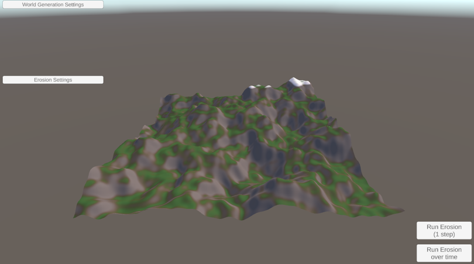
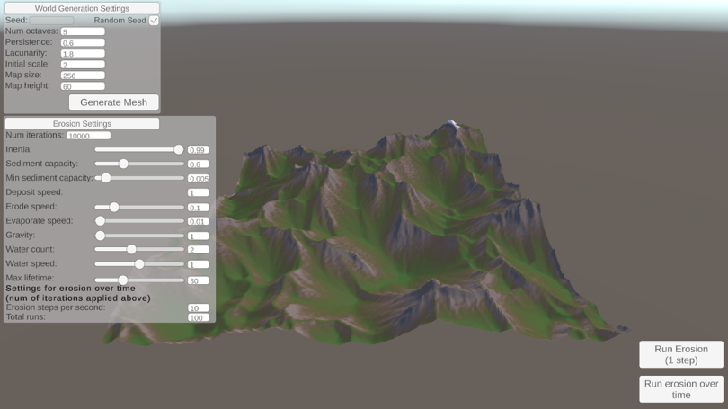

# Simulation of Terrain Erosion Caused by Water

Real-time simulation of hydraulic terrain erosion implemented in Unity. Bachelor's thesis, Faculty of Electrical Engineering and Computing (FER), University of Zagreb, 2025.

## Overview
A computer-based solution for simulating water-induced terrain erosion. 
A randomly generated terrain is subjected to a large number of water particles that change its appearance with their movement, creating an erosion effect. 
Using an erosion algorithm, the real-world physical rules are translated to computer instructions that simulate the long-term process of erosion in human-perceivable time. 
The user can change erosion and terrain generation parameters through the user interface.

## Features
- adjustable or randomly generated heightmap terrain
- erosion, sediment transport and deposition
- adjustable parameters: rainfall amount, evaporation, erosion strength, sediment capacity
- CPU used for erosion, GPU for shaders

Main scripts:
- [`Assets/Scripts/ErosionController.cs`][`Assets/Scripts/ErosionOverTimeController.cs`][`Assets/Scripts/ErosionUIController.cs`]: erosion handling scripts, including UI handler
- [`Assets/Scripts/HeightMapGenerator.cs`][`Assets/Scripts/TerrainMeshGenerator.cs`][`Assets/Scripts/WorldGenUIController.cs`]: world-gen handling

## Results
 

## Requirements
- Unity 2022.3.51f1

## Documentation
- [Bachelor's thesis (PDF, Croatian)](docs/thesis.pdf)
- [Presentation (PDF)](docs/presentation.pdf) *(if applicable)*

## Author
Mislav Marinović